# Footage plan — 2026-10-15-reviewing-rome-s-biggest-bathhouse-for-real
Video model `veo-3.1-fast-generate-preview` at 720p. 11 shots, 74s of clips ≈ **$7.42** (≤ $14.84 if every shot needs a retry).
Spent so far: $9.45 of the $25.00 budget.
Check each first frame: same person every time, period-correct place, no text or logos, the face clear of the caption area (lower third).
| shot | clip | line | still |
|---|---|---|---|
| `00-hook-1` | 4s | Rome's biggest bathhouse. Reviewed. | 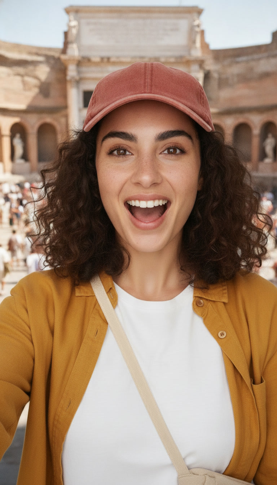 |
| `01-arrival-1` | 8s | It's around the year two hundred and sixteen, and the Baths of Caracalla are brand new. | 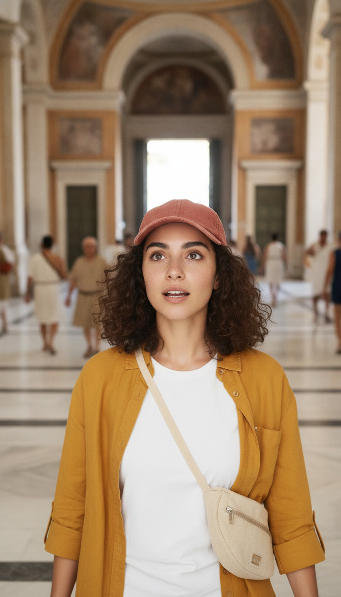 |
| `01-arrival-2` | 8s | Entry costs one tiny coin. And there's room for about sixteen hundred people at once. | 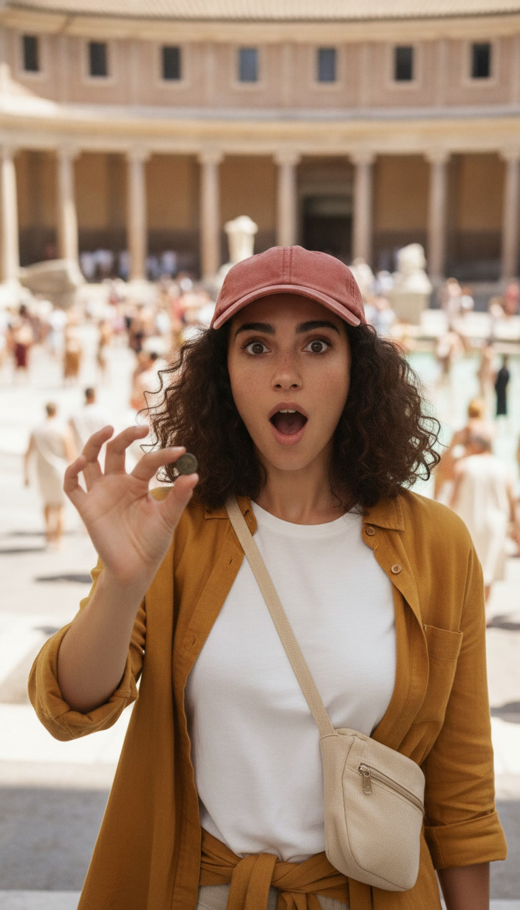 |
| `02-tour-1` | 8s | First stop, the warm room. Then the hot room, heated by fires under the floor. | 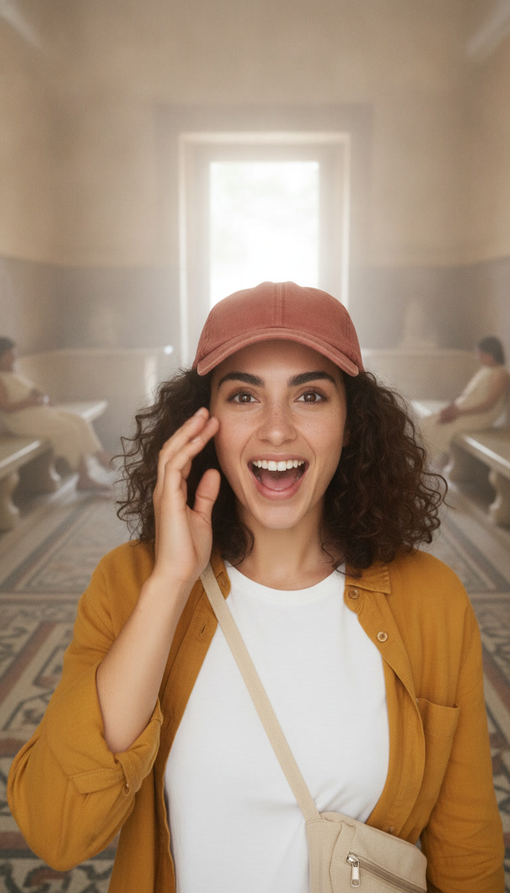 |
| `02-tour-2` | 6s | Then a cold pool under a ceiling over thirty metres high. | 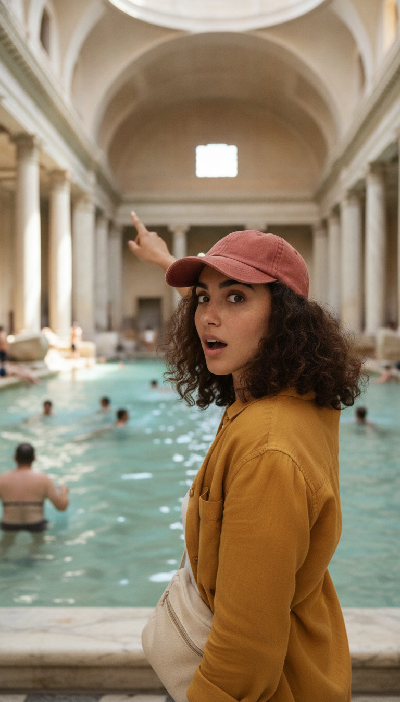 |
| `02-tour-3` | 6s | Oh, and there's a library. At the baths. | 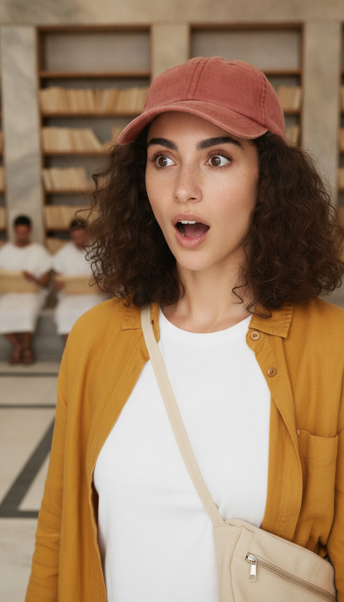 |
| `03-catch-1` | 4s | The catch: there's no soap. | 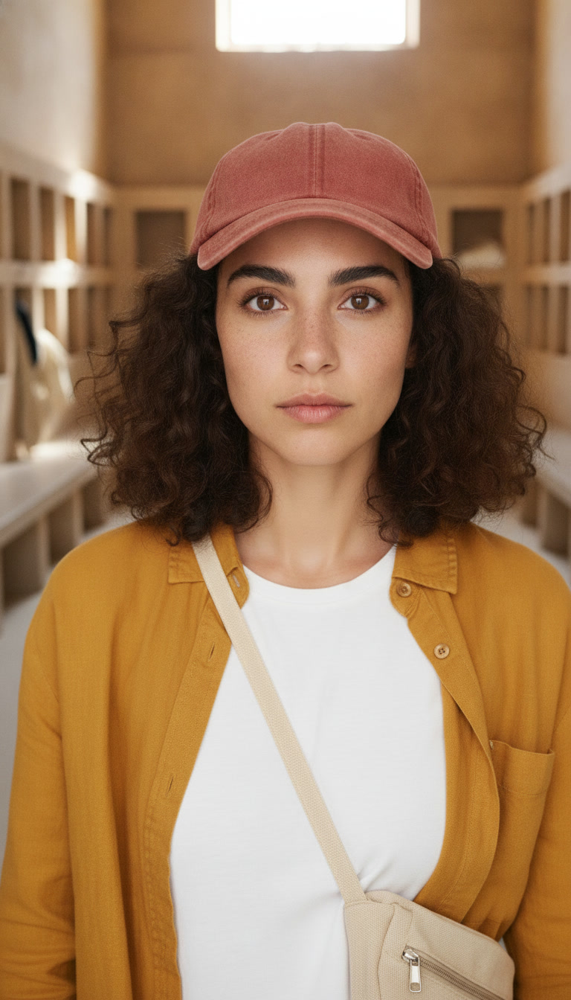 |
| `03-catch-2` | 8s | You rub olive oil on your skin, then scrape it off with a curved metal strigil. | 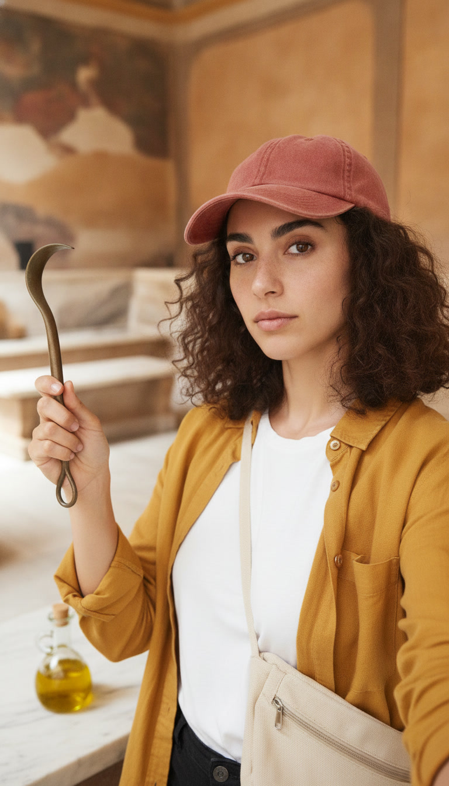 |
| `03-catch-3` | 6s | And those fires under the floor? Enslaved workers keep them going. | 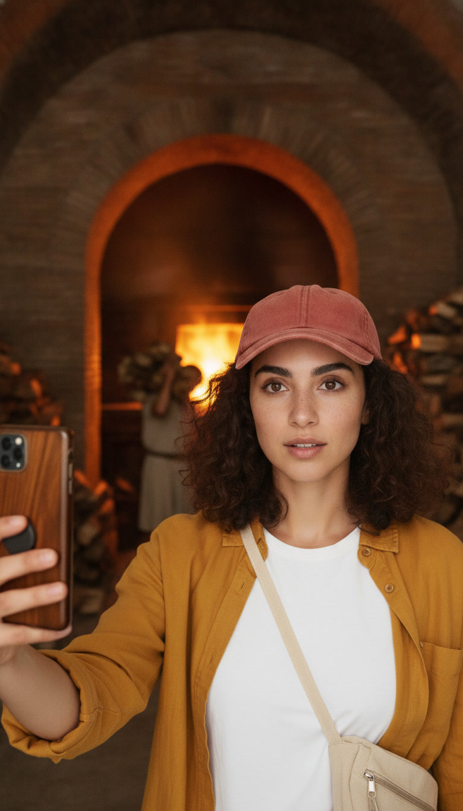 |
| `04-rating-1` | 8s | Okay, review time: the building gets five out of five. The soap situation gets one. | 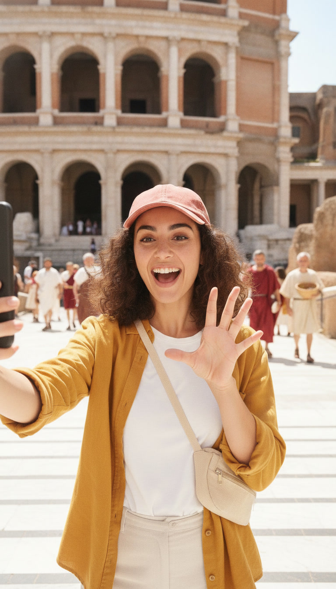 |
| `04-rating-2` | 8s | A gym, a spa and a library for one coin? Rome, I get it. | 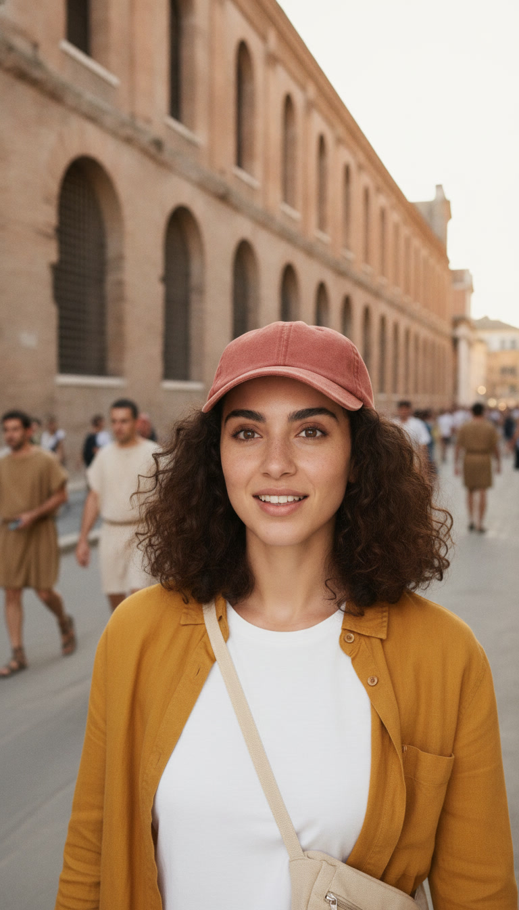 |
