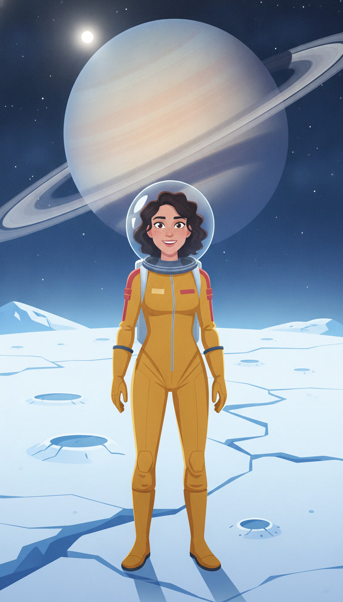
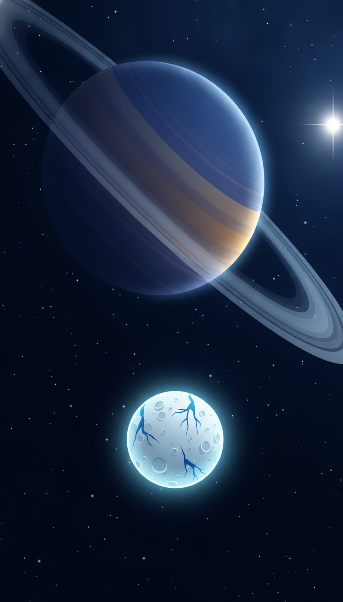
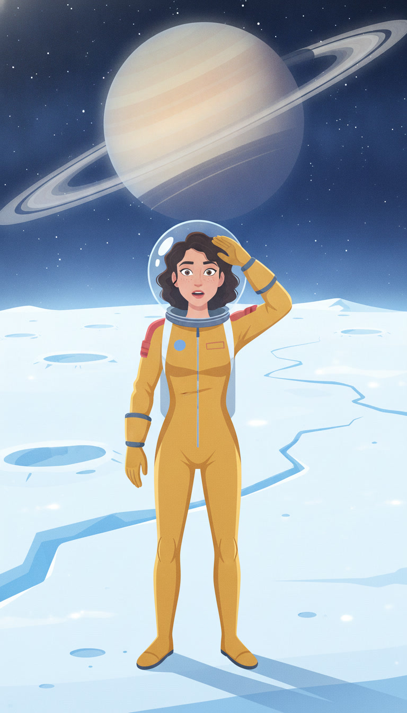
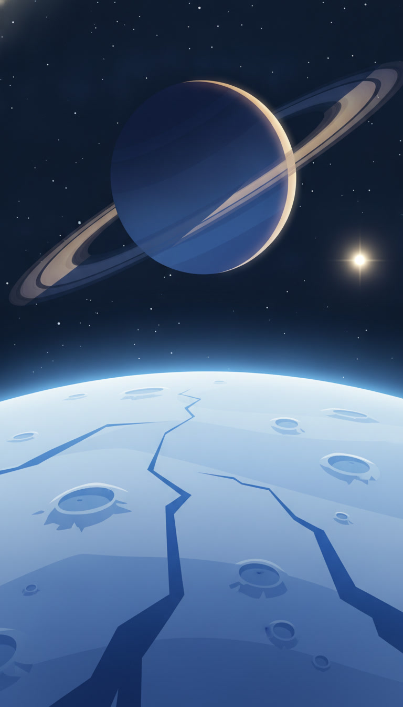
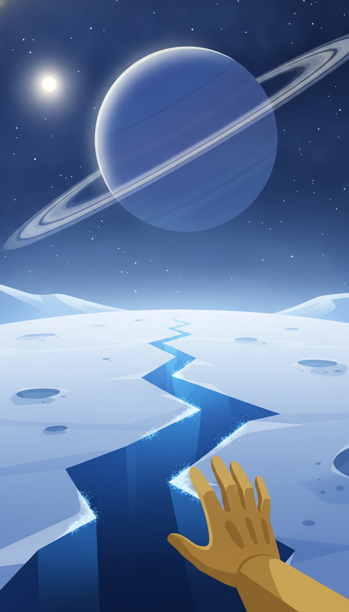
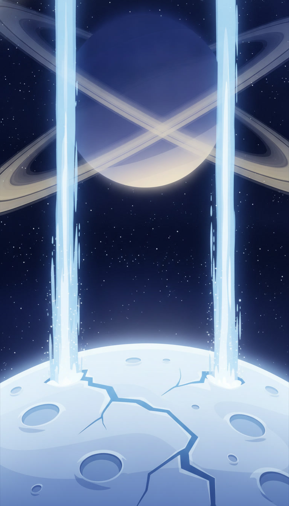
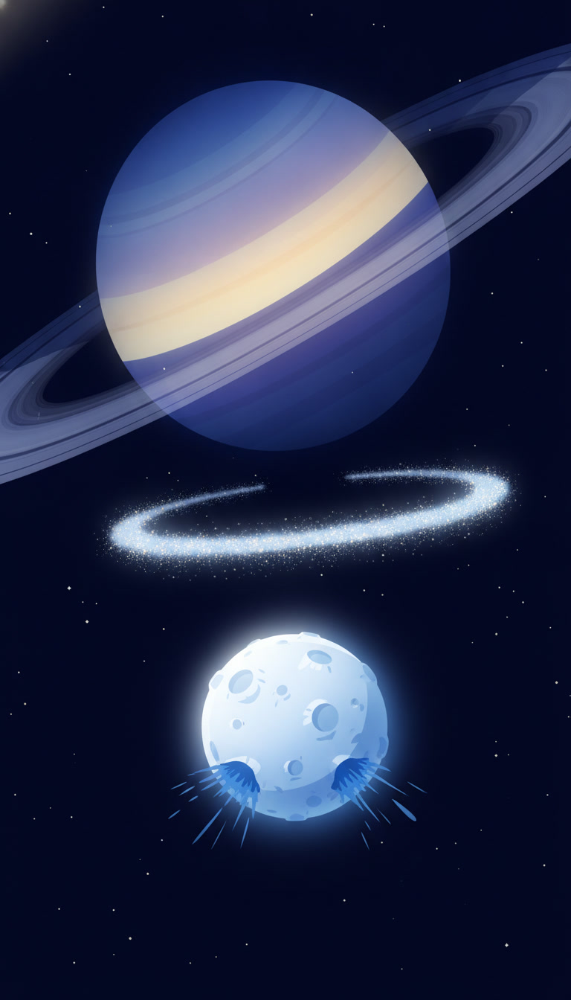
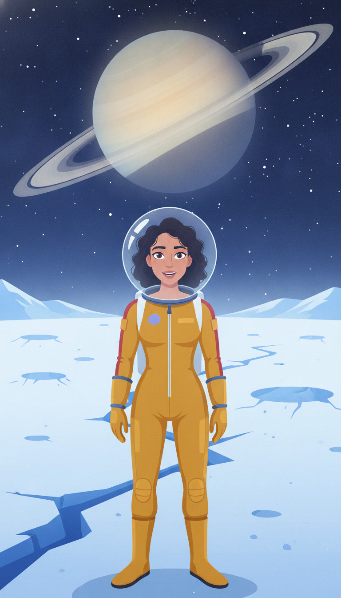
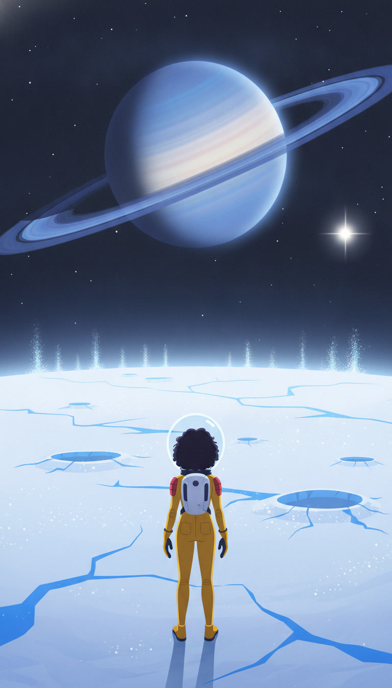

# Footage plan — 2026-10-16-enceladus-ice-geysers
Video model `veo-3.1-fast-generate-preview` at 720p. 10 shots, 62s of clips ≈ **$6.22** (≤ $12.44 if every shot needs a retry).
Spent so far: $7.89 of the $25.00 budget.
Check each first frame: same person every time, period-correct place, no text or logos, the face clear of the caption area (lower third).
| shot | clip | line | still |
|---|---|---|---|
| `00-hook-1` | 6s | Ice everywhere. I'm standing on Enceladus, one of Saturn's moons. |  |
| `01-arrival-1` | 6s | This whole moon is only about five hundred kilometres wide. |  |
| `01-arrival-2` | 6s | And it's so bright, it reflects almost all the sunlight that hits it. |  |
| `02-tour-1` | 6s | Saturn hangs right there in the sky. It never moves. |  |
| `02-tour-2` | 6s | Down south, there are long cracks in the ice called tiger stripes. |  |
| `02-tour-3` | 6s | And they spray giant jets of ice into space. |  |
| `03-catch-1` | 6s | The catch? Under all this ice, there's a whole ocean of liquid water. |  |
| `03-catch-2` | 6s | Some of the spray even ends up feeding one of Saturn's rings. |  |
| `04-rating-1` | 8s | Okay, review time. View, five out of five. Minus two hundred degrees? One star. |  |
| `04-rating-2` | 6s | A tiny moon with a secret ocean. I'm obsessed. |  |
