# Footage plan — 2026-10-16-saturn-s-hexagon-storm-up-close
Video model `veo-3.1-fast-generate-preview` at 720p. 11 shots, 66s of clips ≈ **$6.62** (≤ $13.24 if every shot needs a retry).
Spent so far: $9.23 of the $25.00 budget.
Check each first frame: same person every time, period-correct place, no text or logos, the face clear of the caption area (lower third).
| shot | clip | line | still |
|---|---|---|---|
| `00-hook-1` | 6s | A hexagon. On Saturn. And I'm floating right above it. | 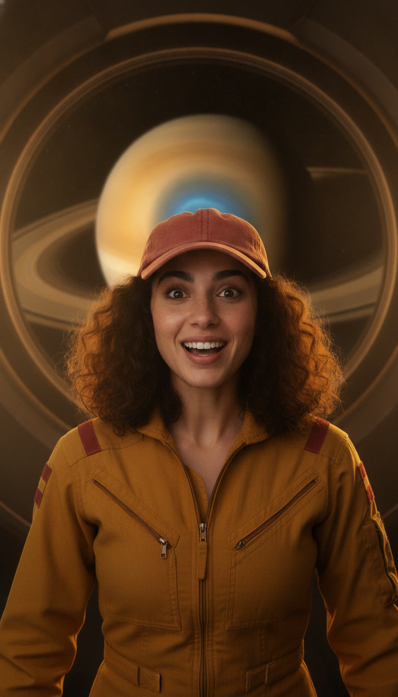 |
| `01-arrival-1` | 6s | We're over a billion kilometres from home, above Saturn's north pole. | 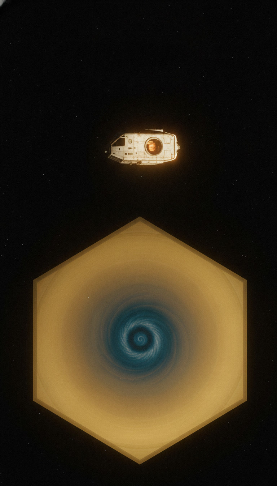 |
| `01-arrival-2` | 6s | No landing, by the way. Saturn has no solid surface to stand on. | 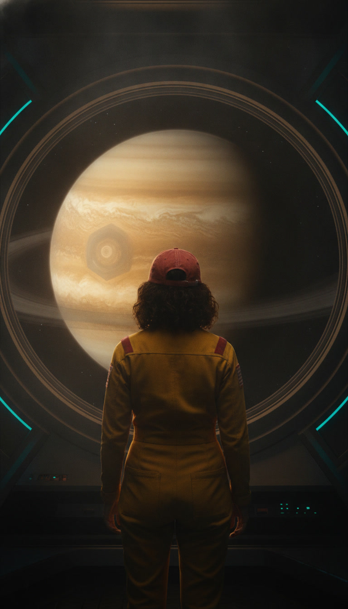 |
| `02-tour-1` | 6s | First, the shape. A six-sided storm, and each side is wider than Earth. | 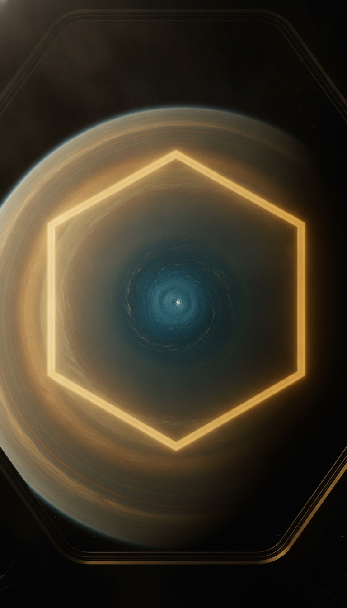 |
| `02-tour-2` | 6s | The wind racing along its edge? Over three hundred kilometres an hour. | 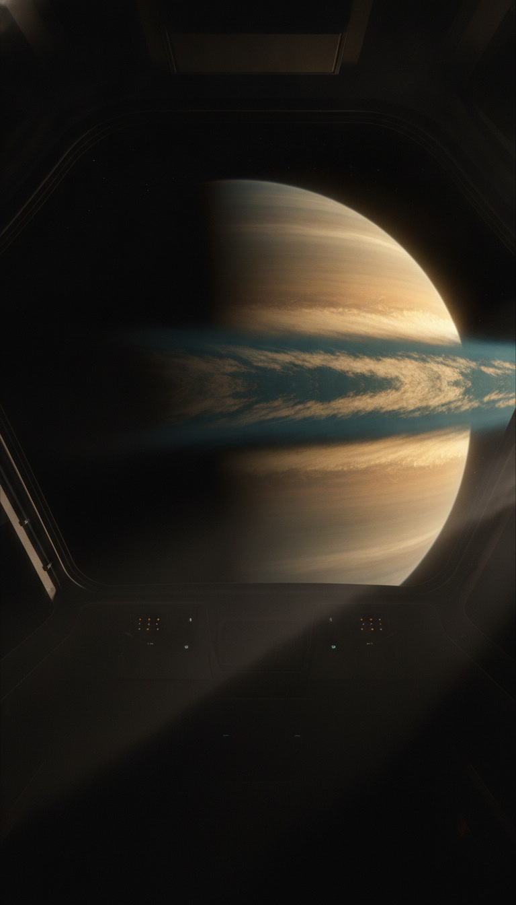 |
| `02-tour-3` | 8s | And it's not new. Voyager spotted it in the early eighties. Cassini found it still there, decades later. | 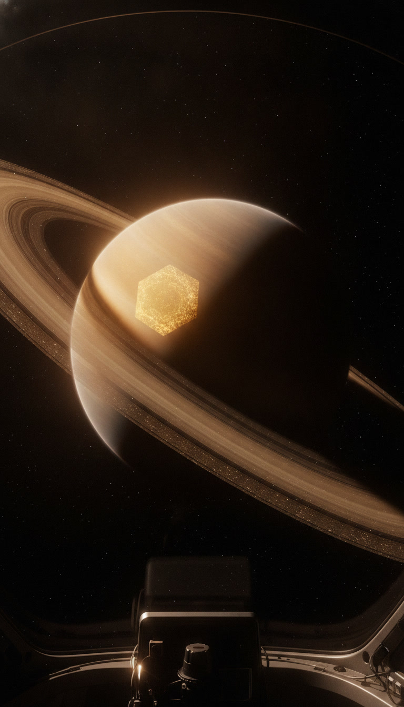 |
| `03-catch-1` | 6s | The catch? Nobody's totally sure why it has six sides. | 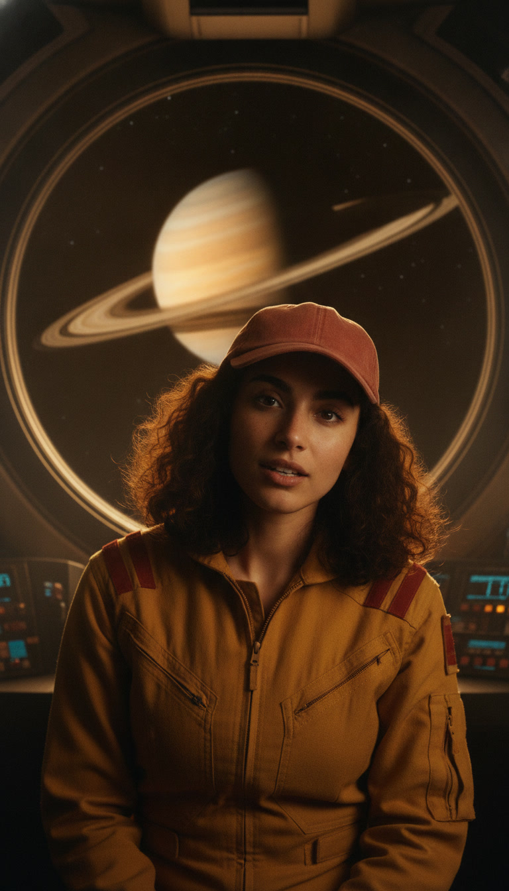 |
| `03-catch-2` | 6s | Lab tanks of spinning water make shapes like it. | 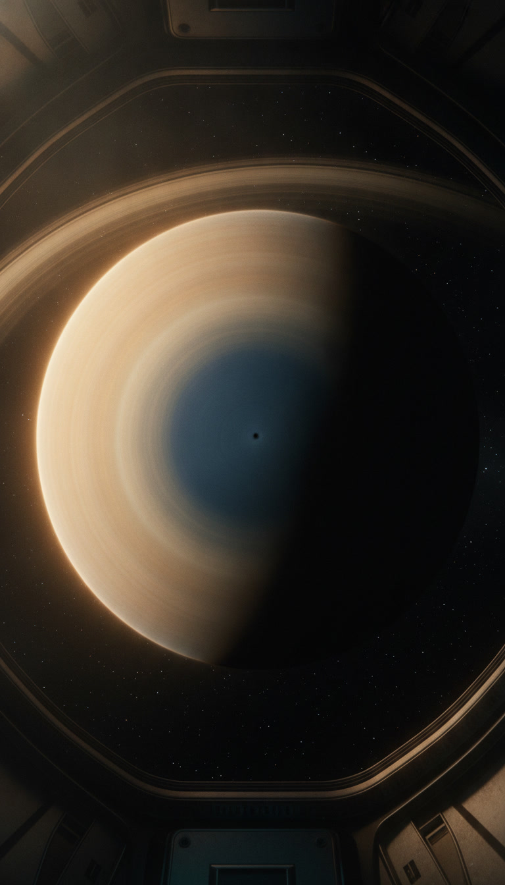 |
| `03-catch-3` | 4s | And the south pole? No hexagon. Weird. | 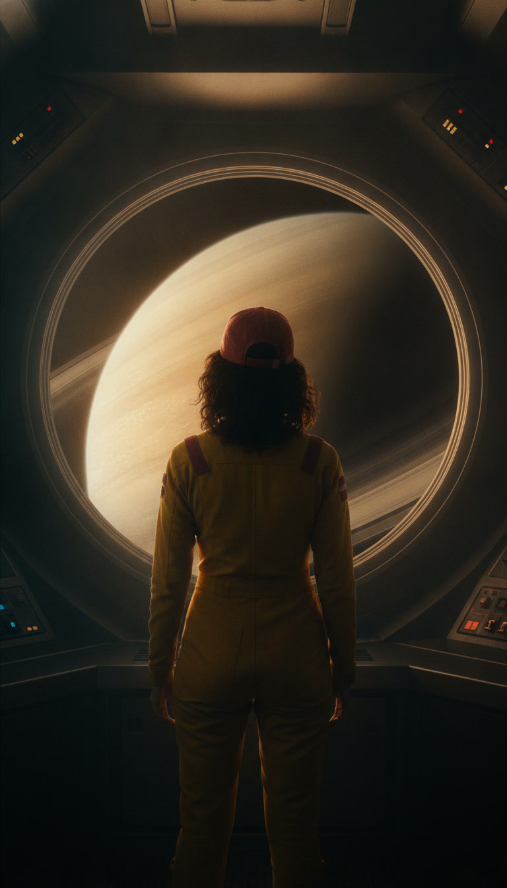 |
| `04-rating-1` | 6s | Okay, review time. View, five out of five. Snacks, one out of five. | 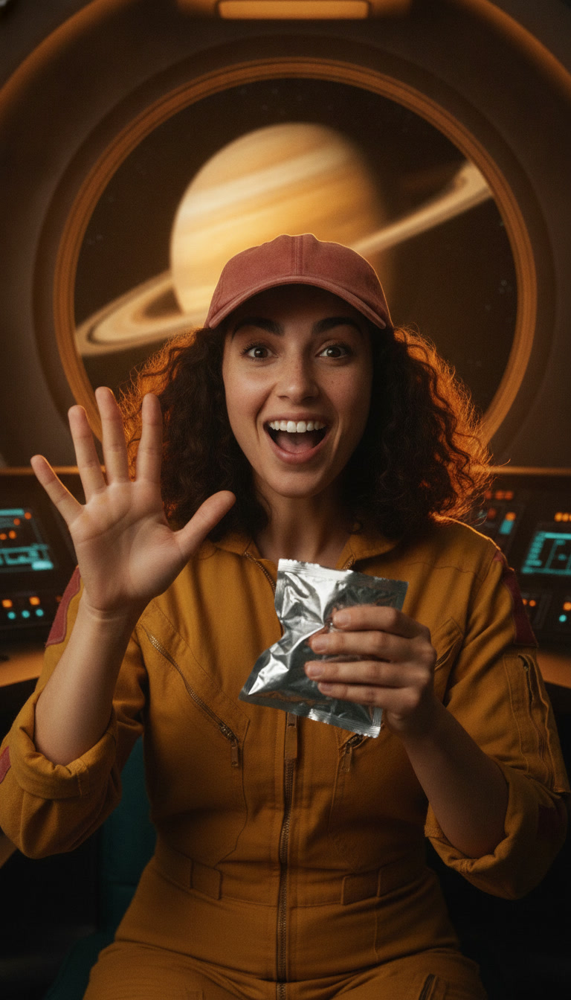 |
| `04-rating-2` | 6s | The universe makes hexagons for fun. I'm obsessed. | 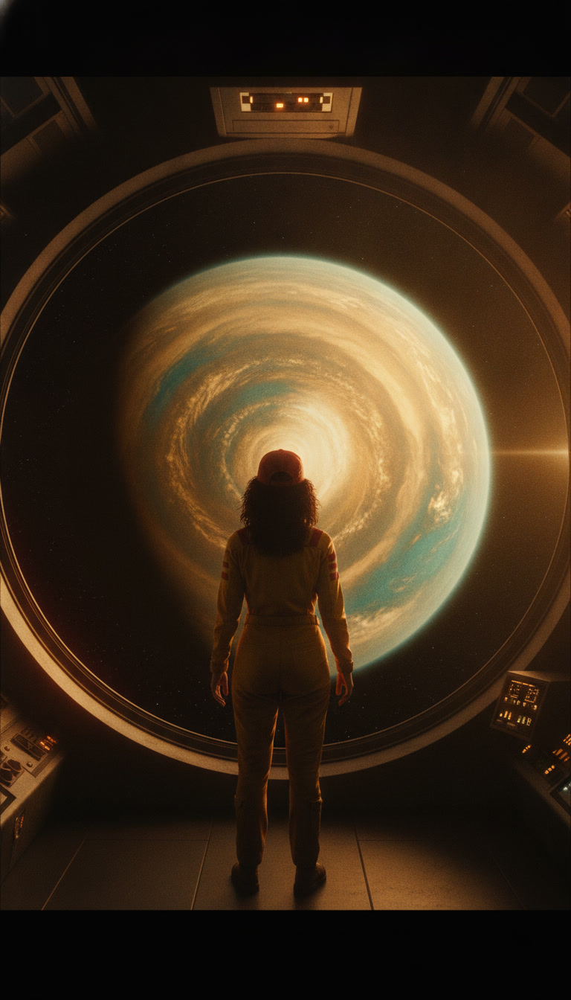 |
