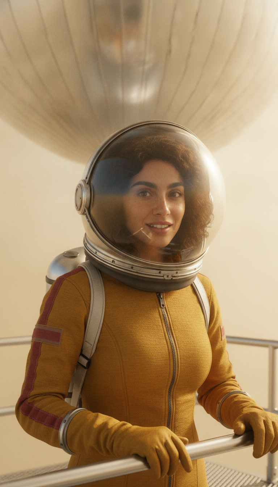
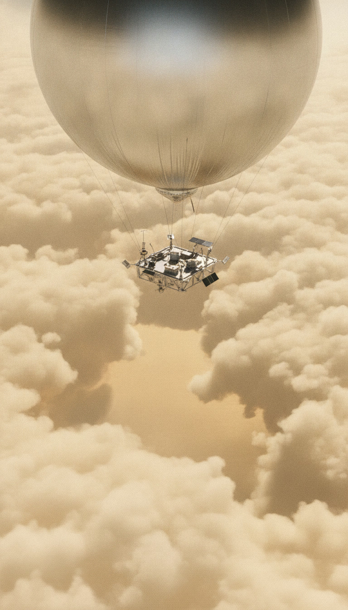
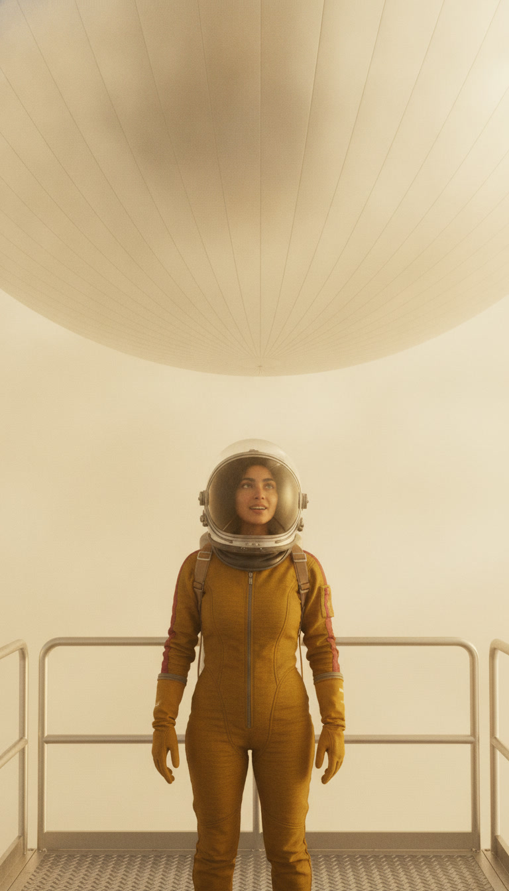
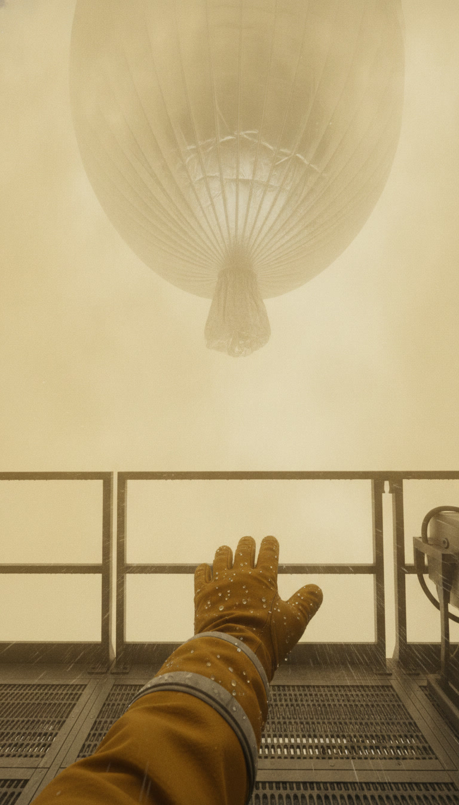
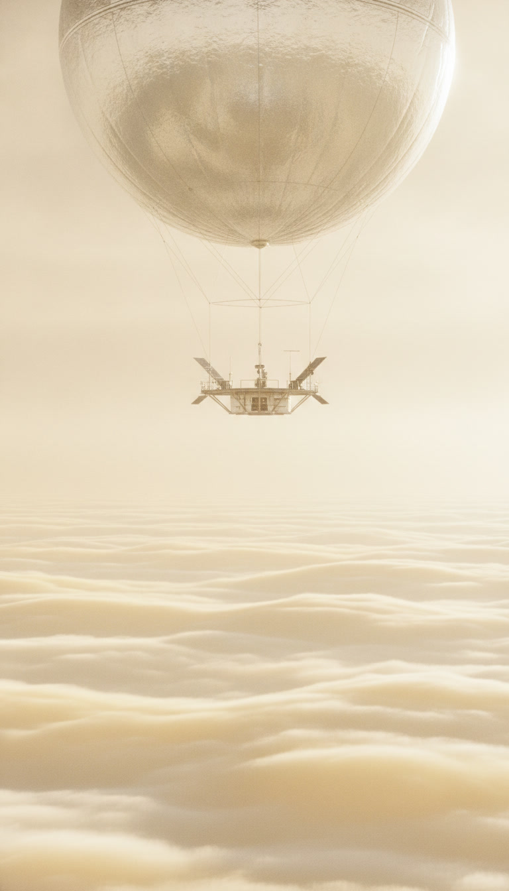
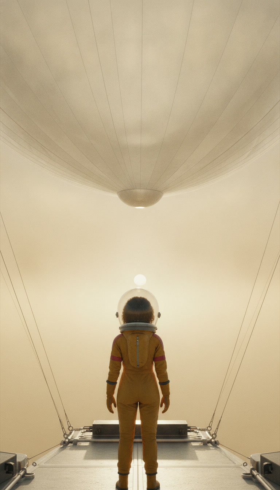
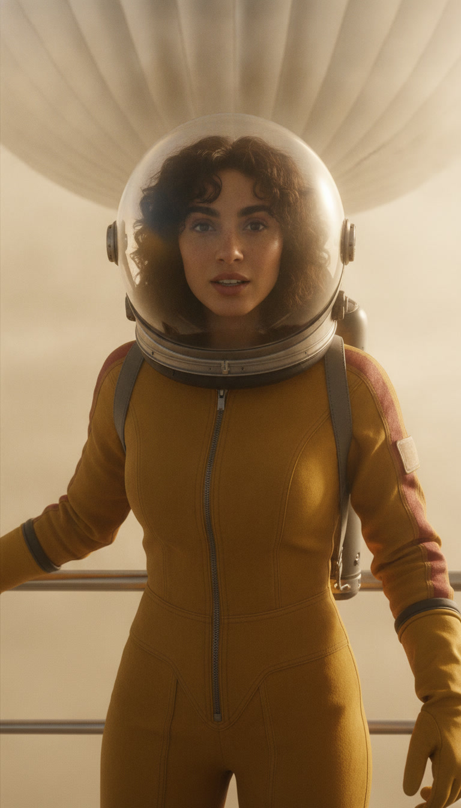
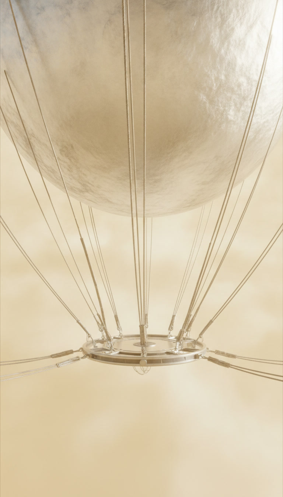
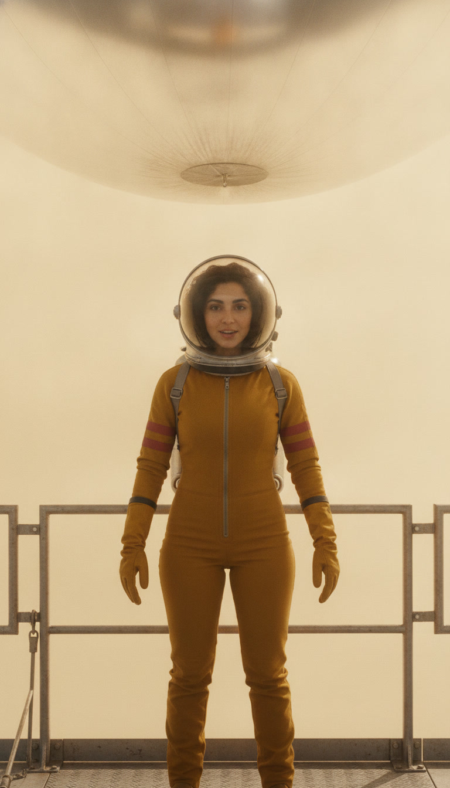
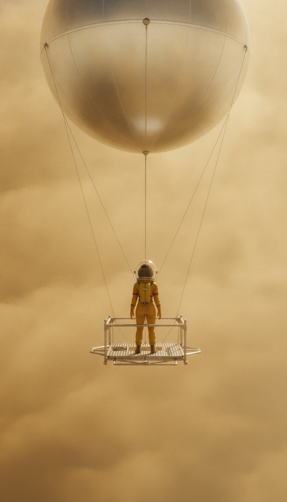

# Footage plan — 2026-10-16-venus-by-balloon-the-one-nice-layer
Video model `veo-3.1-fast-generate-preview` at 720p. 10 shots, 66s of clips ≈ **$6.62** (≤ $13.24 if every shot needs a retry).
Spent so far: $8.69 of the $25.00 budget.
Check each first frame: same person every time, period-correct place, no text or logos, the face clear of the caption area (lower third).
| shot | clip | line | still |
|---|---|---|---|
| `00-hook-1` | 6s | I'm floating. On Venus. Fifty kilometres above the ground. |  |
| `01-arrival-1` | 6s | Down there it's hot enough to melt lead. |  |
| `01-arrival-2` | 6s | Up here, the air pressure is about the same as back home. |  |
| `02-tour-1` | 6s | But these clouds aren't water. They're droplets of sulfuric acid. |  |
| `02-tour-2` | 8s | And the wind up here carries the clouds around the whole planet in about four days. |  |
| `02-tour-3` | 6s | Oh, and the sun rises in the west. Venus spins backwards. |  |
| `03-catch-1` | 8s | The catch? Down on the ground, the air pressure is about ninety times Earth's. |  |
| `03-catch-2` | 6s | And our balloon floats on plain breathable air. Here, that's a lifting gas. |  |
| `04-rating-1` | 8s | Okay, review time. View, five out of five. Acid clouds, one out of five. |  |
| `04-rating-2` | 6s | Strangest weather in the solar system. I'd come back. |  |
